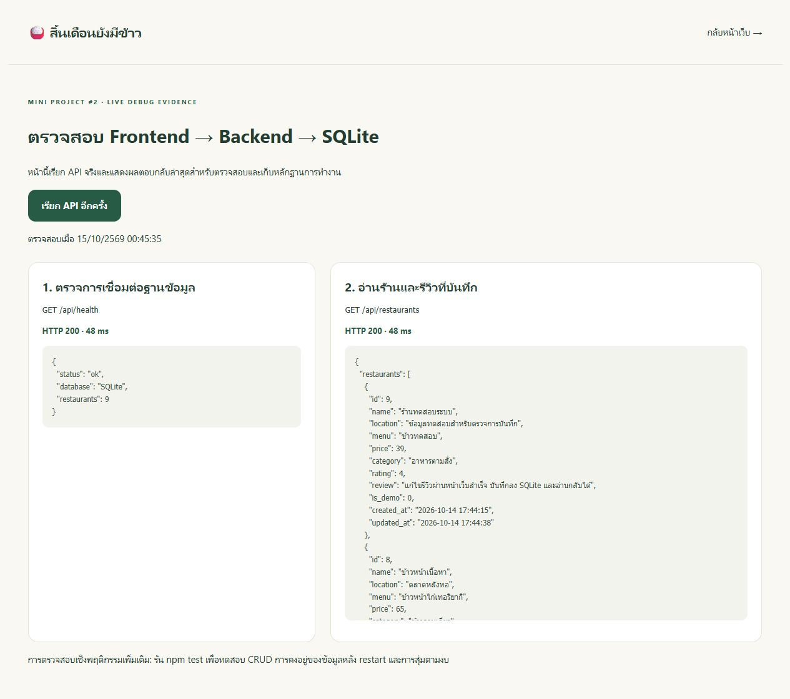

# 🍚 สิ้นเดือนยังมีข้าว

**เว็บแอปรีวิวและสุ่มร้านอาหารรอบมหาวิทยาลัยตามงบประมาณ**  
Mini Project #2 — สร้างเว็บไซต์พร้อมเชื่อมต่อฐานข้อมูล

“งบน้อยได้ แต่ต้องอิ่มอร่อย” — สมุดร้านอาหารส่วนตัวสำหรับนักศึกษา ช่วยจดเมนู ราคา คะแนน และความคิดเห็น แล้วสุ่มร้านสำหรับมื้อต่อไปตามงบที่กำหนด

> ร้านเริ่มต้น 8 ร้านเป็น **ข้อมูลสมมติสำหรับสาธิต** ไม่ใช่ข้อมูลร้าน ราคา หรือตำแหน่งที่ตรวจสอบแล้ว ทุกข้อมูลเริ่มต้นมีป้าย “ข้อมูลสาธิต” สามารถเพิ่มร้านจริงผ่านหน้าเว็บได้

## ขอบเขตและฟีเจอร์

Resource หลักมีเพียง **ร้านอาหาร (`restaurants`)** โดยหนึ่งร้านมีหนึ่งเมนูแนะนำ หนึ่งคะแนน และหนึ่งรีวิวส่วนตัว

- เพิ่ม ดู แก้ไข และลบร้านอาหาร (CRUD)
- เก็บชื่อร้าน ตำแหน่งแบบข้อความ เมนูแนะนำ ราคา และประเภทอาหาร
- ให้คะแนน 1–5 ดาว และเขียน/แก้ไขความคิดเห็น
- ค้นหาชื่อร้าน เมนู หรือตำแหน่ง และกรองประเภทอาหาร
- กำหนดงบเอง หรือเลือกงบลัด 35 / 50 / 80 / 100 บาท
- สุ่มร้านที่ **ราคาเมนูแนะนำไม่เกินงบ** และตรงกับประเภท/คำค้นที่เลือก
- แสดงเงินเหลือ และแจ้งเมื่อไม่มีร้านที่ตรงเงื่อนไข
- บันทึกข้อมูลใน SQLite จริง ข้อมูลยังอยู่หลังรีเฟรชหรือปิด–เปิดเซิร์ฟเวอร์
- หน้าตรวจสอบระบบสำหรับดู API และข้อมูลจากฐานข้อมูล
- รองรับหน้าจอคอมพิวเตอร์และหน้าจอขนาดเล็ก

คะแนนเป็นคะแนนส่วนตัว ไม่ใช่ค่าเฉลี่ยจากผู้ใช้หลายคน โปรเจกต์นี้ไม่มีระบบสมาชิก ไม่มีแผนที่สด และไม่มีระบบสั่งซื้ออาหาร ราคาที่ใช้สุ่มคือราคาของเมนูแนะนำ ไม่รวมรายการเพิ่มเติม เช่น เครื่องดื่มหรือไข่ดาว

## เทคโนโลยี

| ส่วน | เทคโนโลยี | หน้าที่ |
| --- | --- | --- |
| Frontend | HTML, CSS, JavaScript | หน้าจอ แบบฟอร์ม ตัวกรอง และแสดงผล |
| Backend | Node.js HTTP server | รับ request ตรวจข้อมูล และจัดการ API |
| Database | SQLite ผ่าน `node:sqlite` | เก็บร้าน ราคา คะแนน และรีวิวลงไฟล์ |
| Tests | Node.js test runner | ทดสอบ API และการคงอยู่ของข้อมูล |

ใช้โมดูลที่มีมากับ Node.js ไม่ต้องติดตั้ง MySQL หรือบริการฐานข้อมูลภายนอก ไม่มี npm dependency เพิ่มเติม

## วิธีติดตั้งและรัน

ต้องใช้ **Node.js 24 ขึ้นไป** และ npm (ทดสอบด้วย Node.js 24.21.0)

1. ดาวน์โหลด ZIP จาก GitHub หรือ clone repository แล้วเปิดโฟลเดอร์โปรเจกต์
2. เปิด Terminal ในโฟลเดอร์ที่มี `package.json`
3. ตรวจเวอร์ชันและติดตั้งตามคำสั่ง:

```sh
node --version
npm install
```

4. เริ่มโปรเจกต์:

```sh
npm run dev
```

5. เปิด **http://localhost:3000** ในเบราว์เซอร์

ครั้งแรกระบบจะสร้าง `data/restaurants.sqlite` และเติมข้อมูลสาธิต 8 ร้านให้อัตโนมัติ การรันครั้งต่อไปใช้ข้อมูลเดิม หากลบร้านทั้งหมด ระบบจะไม่เติมข้อมูลสาธิตกลับมาเอง

หยุดเซิร์ฟเวอร์ด้วย `Ctrl+C` และเริ่มใหม่ด้วยคำสั่งเดิม หากต้องการรันโดยไม่เฝ้าดูการแก้ไขไฟล์ ใช้ `npm start`

หากพอร์ต 3000 ถูกใช้งาน บน PowerShell ให้ใช้:

```powershell
$env:PORT = '3001'
npm run dev
```

จากนั้นเปิด http://localhost:3001 โปรเจกต์ฟังเฉพาะเครื่องตัวเอง (`127.0.0.1`) เหมาะสำหรับรันสาธิตตามโจทย์ ไม่จำเป็นต้องนำเว็บขึ้น host

## โครงสร้างโปรเจกต์

```text
sin-duen-yang-mee-khao/
├── public/                  # Frontend
│   ├── index.html           # หน้าเว็บหลัก
│   ├── styles.css           # ดีไซน์และ responsive layout
│   ├── app.js               # UI และการเรียก API
│   ├── favicon.svg          # ไอคอนเว็บไซต์
│   ├── debug.html           # หน้าตรวจสอบระบบ
│   └── debug.js             # เรียก API จริงเพื่อแสดงหลักฐาน
├── server/                  # Backend
│   ├── index.js             # HTTP server, routes และ validation
│   ├── database.js          # เชื่อมต่อ SQLite และสร้างตาราง
│   └── seed.js              # ข้อมูลสาธิตเริ่มต้น
├── data/                    # สร้างอัตโนมัติเมื่อรัน
│   └── restaurants.sqlite   # ฐานข้อมูลของแต่ละเครื่อง (ไม่ใส่ Git)
├── test/
│   └── api.test.js          # Integration tests
├── docs/
│   ├── screenshots/         # ภาพหลักฐานจากระบบที่รันจริง
│   ├── test-results.txt     # ผล npm test
│   └── presentation.md      # แนวทางสาธิตและอธิบายโค้ด
├── .gitignore
├── package.json
├── package-lock.json
└── README.md
```

## การไหลของข้อมูล

```text
ผู้ใช้กรอกฟอร์ม / เลือกงบ
          ↓
Frontend (public/app.js) ส่ง fetch request
          ↓
Backend (server/index.js) ตรวจสอบข้อมูล
          ↓
SQLite (data/restaurants.sqlite) บันทึกหรืออ่านข้อมูล
          ↓
Backend ส่ง JSON กลับ → Frontend แสดงการ์ดร้าน / ผลสุ่ม
```

การสุ่มเกิดที่ Backend: กรองรายการด้วย `price <= budget` พร้อมประเภทและคำค้นก่อน แล้วสุ่มหนึ่งร้านจากรายการที่ผ่านเงื่อนไข ด้วย `randomInt` ของ Node.js จึงไม่สุ่มร้านเกินงบ การสุ่มซ้ำอาจได้ร้านเดิมได้ตามปกติ

## โครงสร้างฐานข้อมูล

ตาราง `restaurants` มีคอลัมน์ดังนี้:

| คอลัมน์ | ชนิด | ความหมาย |
| --- | --- | --- |
| `id` | INTEGER PRIMARY KEY | รหัสร้าน สร้างอัตโนมัติ |
| `name` | TEXT | ชื่อร้าน สูงสุด 100 ตัวอักษร |
| `location` | TEXT | ตำแหน่งร้าน สูงสุด 200 ตัวอักษร |
| `menu` | TEXT | เมนูแนะนำ สูงสุด 100 ตัวอักษร |
| `price` | REAL | ราคา มากกว่า 0 ถึง 10,000 บาท ทศนิยมไม่เกิน 2 ตำแหน่ง |
| `category` | TEXT | ประเภทอาหารจากตัวเลือกที่กำหนด |
| `rating` | INTEGER | คะแนนจำนวนเต็ม 1–5 |
| `review` | TEXT | รีวิวส่วนตัว สูงสุด 1,000 ตัวอักษร ว่างได้ |
| `is_demo` | INTEGER | 1 = ข้อมูลสาธิต, 0 = ร้านที่เพิ่มเอง |
| `created_at` | TEXT | วันเวลาสร้างข้อมูล (UTC) |
| `updated_at` | TEXT | วันเวลาแก้ไขล่าสุด (UTC) |

ใช้ prepared statements เพื่อแยกข้อมูลผู้ใช้จากคำสั่ง SQL และ escape ข้อความที่แสดงบนหน้าเว็บ เพื่อให้รีวิวที่มีเครื่องหมาย HTML แสดงเป็นข้อความ

## รายการ API endpoints ทั้งหมด

Base URL: `http://localhost:3000`

| Method | Endpoint | หน้าที่ | ผลสำเร็จ |
| --- | --- | --- | --- |
| GET | `/api/health` | ตรวจการเชื่อมต่อ SQLite และจำนวนร้าน | 200 |
| GET | `/api/restaurants` | อ่านรายการร้าน พร้อมตัวกรอง | 200 |
| GET | `/api/restaurants/random` | สุ่มร้านจากรายการที่ผ่านตัวกรอง | 200 |
| GET | `/api/restaurants/:id` | อ่านร้านตามรหัส | 200 |
| POST | `/api/restaurants` | เพิ่มร้านพร้อมคะแนนและรีวิว | 201 |
| PUT | `/api/restaurants/:id` | แก้ข้อมูลร้าน คะแนน และรีวิว | 200 |
| DELETE | `/api/restaurants/:id` | ลบร้าน | 200 |

GET รายการร้านและการสุ่มใช้ query parameters เดียวกัน:

- `budget`: งบสูงสุด 0–10,000 บาท หากไม่ส่งจะไม่จำกัดงบ
- `category`: อาหารตามสั่ง / ก๋วยเตี๋ยว / ข้าวจานเดียว / อีสาน / มังสวิรัติ / อื่น ๆ
- `q`: ค้นหาชื่อร้าน เมนู หรือตำแหน่ง ไม่เกิน 100 ตัวอักษร

ตัวอย่าง: `/api/restaurants?budget=50` และ `/api/restaurants/random?budget=40`

ข้อมูล POST และ PUT ต้องส่ง `Content-Type: application/json` และครบทุกฟิลด์ต่อไปนี้ (`review` ส่งเป็นสตริงว่างได้):

```json
{
  "name": "ร้านตัวอย่างของฉัน",
  "location": "ข้างคณะ",
  "menu": "ข้าวไข่เจียว",
  "price": 35,
  "category": "อาหารตามสั่ง",
  "rating": 4,
  "review": "อิ่มคุ้มราคา ได้อาหารเร็ว"
}
```

ผลการอ่านรายการใช้ `{ "restaurants": [...] }`; การเพิ่ม อ่านรายร้าน และแก้ไขใช้ `{ "restaurant": {...} }`; การสุ่มมี `matched` ระบุจำนวนร้านที่ผ่านตัวกรอง; การลบตอบ `{ "message": "ลบร้านแล้ว" }`

ผลผิดพลาดใช้ `{ "error": "ข้อความอธิบาย" }` และสถานะ 400 (ข้อมูลไม่ถูกต้อง), 404 (ไม่พบร้าน/ไม่มีร้านให้สุ่ม/ไม่พบเส้นทาง), 413 (body ใหญ่เกิน 16 KiB), 415 (Content-Type ไม่ถูกต้อง) หรือ 500 (ปัญหาภายใน)

หน้าเว็บที่ให้บริการ: `/` และ `/debug.html` ส่วนไฟล์ static คือ `/styles.css`, `/app.js`, `/debug.js` และ `/favicon.svg`

## การตรวจสอบและหลักฐาน

รันการทดสอบอัตโนมัติ:

```sh
npm test
```

ผลการรันทดสอบ: **ผ่าน 6 ชุด / ไม่ผ่าน 0 ชุด** ดูผลจริงใน [docs/test-results.txt](docs/test-results.txt)

1. หน้าเว็บและไฟล์ Frontend โหลดได้ และเชื่อมต่อ SQLite
2. ค้นหา/กรองงบและประเภทพร้อมกัน รวมกรณีราคาเท่ากับงบ
3. สุ่ม 20 ครั้งได้เฉพาะร้านที่อยู่ในงบและประเภทที่เลือก รวมกรณีไม่มีร้าน
4. ปฏิเสธราคา คะแนน ประเภท คำค้น และ JSON ที่ไม่ถูกต้อง
5. เพิ่ม → อ่าน → แก้ไข → ตรวจค่าจริงใน SQLite → restart → อ่านข้อมูลเดิม → ลบ
6. ลบร้านทั้งหมดแล้ว restart ไม่สร้างข้อมูลสาธิตกลับมาเอง

Tests ใช้ฐานข้อมูลชั่วคราวแยกจากข้อมูลใช้งานจริง และลบเฉพาะข้อมูลทดสอบหลังรันเสร็จ

### ภาพหลักฐานที่ 1 — Frontend และการสุ่มตามงบ

ภาพจากหน้าเว็บที่รันจริง ตั้งงบ 50 บาท อ่านร้านผ่าน API และสุ่มเฉพาะร้านที่ราคาไม่เกินงบ


### ภาพหลักฐานที่ 2 — Backend และฐานข้อมูล

เปิด http://localhost:3000/debug.html เพื่อเรียก `GET /api/health` และ `GET /api/restaurants` จริง ภาพแสดง HTTP 200 และรีวิวที่เพิ่ม/แก้ไขผ่านหน้าเว็บแล้วอ่านกลับจาก SQLite ภาพถ่ายระหว่างทดสอบจึงมี 9 ร้าน (8 ร้านสาธิต + 1 ร้านทดสอบ) หลังตรวจสอบได้ลบร้านทดสอบออกแล้ว



ภาพเพิ่มเติม: [แบบฟอร์มรีวิว](docs/screenshots/02-review-form.png) · [หน้าจอขนาดเล็ก](docs/screenshots/04-small-screen.png)

ตรวจผ่านเบราว์เซอร์จริงเพิ่มเติม: เพิ่มร้าน → ให้คะแนน → แก้รีวิว → รีเฟรชแล้วข้อมูลยังอยู่ → ยืนยันและลบร้านทดสอบ ตรวจหน้าจอขนาดเล็กแล้วไม่พบเนื้อหาล้นแนวนอน

### วิธีตรวจสอบด้วยตนเอง

1. เปิดหน้าเว็บและหน้า `/debug.html` คนละแท็บ
2. เพิ่มร้านราคา 39 บาท ให้ 5 ดาว แล้วรีวิว
3. ที่หน้าตรวจระบบกด “เรียก API อีกครั้ง” ควรพบข้อมูลใหม่และ HTTP 200
4. แก้รีวิว/ดาว แล้วรีเฟรชหน้าเว็บเพื่อยืนยันค่าที่บันทึก
5. ลองงบ 10 บาท ระบบควรแจ้งว่าไม่มีร้านตรงเงื่อนไข
6. ปิด–เปิดเซิร์ฟเวอร์ ข้อมูลที่เพิ่มไว้ควรยังอยู่
7. หากต้องการดู request เพิ่มเติม เปิด Developer Tools → Network แล้วเลือก request `/api/restaurants` เพื่อตรวจ method, status และ response; ดู Console เพื่อหาข้อผิดพลาดฝั่งหน้าเว็บ

## การส่งงาน

- รวม Frontend, Backend, README และภาพหลักฐานไว้ใน repository เดียว
- ไม่ต้องอัปโหลด `node_modules` หรือไฟล์ฐานข้อมูลที่ใช้งานจริง เพราะระบบสร้างฐานข้อมูลและข้อมูลสาธิตให้เมื่อเริ่มรัน
- ตรวจว่าคนตรวจงานเข้าถึง repository ได้
- คัดลอก **ลิงก์ repository ของโปรเจกต์นี้** ไปส่งในช่อง assignment ของ Microsoft Teams ตามโจทย์ (ลิงก์หน้าโปรไฟล์ GitHub อย่างเดียวไม่ใช่ลิงก์ repository)
- ไม่ต้อง deploy เว็บขึ้นอินเทอร์เน็ต

## หมายเหตุการพัฒนา

สร้างด้วยความช่วยเหลือของ AI สำหรับจัดโครงสร้าง ออกแบบ เขียนโค้ด และตรวจสอบ ผู้ส่งควรทดลองรันและอ่านโค้ดหลักให้เข้าใจ รวมถึงปฏิบัติตามนโยบายการใช้ AI ของรายวิชา

รูปจานข้าวสร้างด้วย CSS ส่วนสัญลักษณ์อาหารใช้ emoji ไม่มีรูปอาหารจากร้านจริงหรือบริการภายนอก
